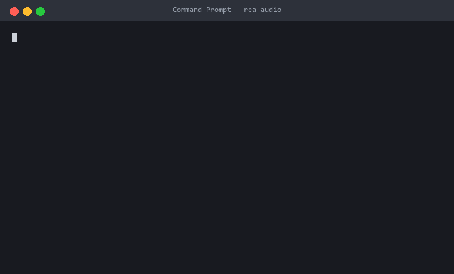

# rea-audio · 逆向一切音频



> 这首歌是不是 AI 做的？多少 BPM、什么调、什么和弦、怎么混的、怎么复刻？
> rea-audio 把一段音频拆成**带证据的结论**——每个数字都能追溯到 findings.json，没有玄学。

**English readme: [README_EN.md](README_EN.md)**

`rea-audio` 是一个命令行音频逆向工具：给它任意音频（wav / flac / ogg / mp3），它输出一份「案卷」（case file）——

- 🥁 **节奏**：BPM（含倍频歧义提示，不装懂）
- 🎹 **和声**：调性（大小调）+ 逐小节和弦进行
- 🎚️ **频谱/立体声**：8 频段能量、双深度滚降、声道相关性与宽度
- 🧩 **结构**：段落切分与能量标注（诚实标注为「假设」）
- 🤖 **AI 鉴定**：五条独立证据链投票判断 AI 生成 / 人类制作 / 无法判定，**每票都给出数值、阈值和被什么因素削弱**
- 🎯 **复刻方案**：从测量结果反推 Suno 风格提示词 + 录音/混音配方 + 复刻验证方法

它的方法论继承自 [REA (Reverse Engineer Anything)](https://github.com/morluto/rea)：**结论必须携带证据，并且诚实区分「事实 / 假设 / 未知」**。rea-audio 是独立的社区衍生项目，与 REA 官方无关（详见[致谢](#致谢)）。

## 快速开始

```bash
pip install numpy soundfile        # 唯一的三个依赖（numpy/soundfile/jinja2）
python -m rea_audio analyze 你的音频.mp3
```

输出目录 `<你的音频>.case/`：

| 文件 | 内容 |
|---|---|
| `report.html` | 人读的案卷报告（单文件、无外部依赖、可直接截图分享） |
| `findings.json` | 机读的全部发现与证据（agent / diff 复刻用） |
| `replication.md` | 复刻方案：风格指纹 + Suno 提示词 + 录音混音配方 |

子命令速查：

```bash
python -m rea_audio detect 你的音频.mp3     # 只做 AI 鉴定
python -m rea_audio chords 你的音频.mp3     # 只看 BPM/调性/和弦
python -m rea_audio replicate 你的音频.mp3  # 只出复刻方案
```

## AI 鉴定是怎么判的（以及它什么时候会认怂）

不是黑盒分类器，是五条**可复核的证据链**投票：

| # | 证据 | 指向 AI | 指向人类 | 会被什么骗到 |
|---|---|---|---|---|
| E1 | 生成带宽边缘（16–19kHz 相对 13–15kHz 的衰减沿，真实曲目校准） | 空气段陡降 ≥15dB（Suno v5 实测 -19~-33dB） | 空气段平坦（人类录音实测 -0.2~-4.5dB）且持续能量存在 | 低码率 MP3、低采样率源（按实测带宽自适应降权） |
| E2 | 空气段纹理 | — | 空气段有真实内容时呈模拟噪底起伏 | — |
| E3 | 响度起伏 | 短时响度几乎恒定 | 动态自然呼吸 | 过度母带压缩的真人作品 |
| E4 | 起拍时钟 | onset 抖动 CV<0.012（量化网格） | — | 量化录音 |
| E5 | 立体声 | 两声道数值完全相同 | 真实立体声像 | — |

**传输降权**：E1 按实测带宽判定可信度 —— 深滚降 ≥17kHz（空气段确实在传输中幸存）或无损格式（FLAC/WAV）权重 1.0；MP3 按码率 0.25~0.75 折扣；源采样率 ≤32kHz 时 E1 弃权。有损压缩会模仿 AI 的带宽指纹，宁可少投票也不冤枉。

证据分裂或总权重不足时，结论就是 `INCONCLUSIVE`。**这不是缺陷，是诚实。**

## 准不准？

**真实曲目校准**（[cases/real-world-v1/](cases/real-world-v1/RESULTS.md)，来源可验证、音频不入库）：

| 组 | 结果 | 关键证据（空气段衰减沿） |
|---|---|---|
| Suno v5.5 生成 ×4（HF 数据集 `Kukedlc/suno-ai-music-dataset`，CC-BY-4.0，API 溯源字段齐全） | **4/4 检出 AI** | -18.7 ~ -32.9 dB（陡降沿） |
| 人类制作 ×3（Wikimedia Commons PD/CC0 + Kevin MacLeod CC-BY-4.0） | **3/3 判定人类，零冤枉** | -0.2 ~ -4.5 dB（平坦空气段） |

**合成自测**（已知答案的数学合成信号，固定种子、零下载、任何机器可复现）：

```bash
python eval/selftest.py
```

当前结果（[eval/RESULTS.md](eval/RESULTS.md)）：tempo 3/3、key 3/3、ai_detect 2/2。

⚠️ 诚实声明：对照组偏古典声学、AI 组偏流行电子，风格与来源尚未完全解耦 —— 欢迎通过 issue 提交更多对照案例（现代流行母带尤佳）。证据分裂或权重不足时输出 `INCONCLUSIVE`，这不是缺陷，是诚实。

## 给 agent 用（Claude Code / Codex / Cursor）

把 [prompts/rea-audio-skill.md](prompts/rea-audio-skill.md) 喂给你的编码 agent，它就能自主完成「听→拆→判→复刻」的完整工作流：跑 CLI、读 findings.json、交叉验证结论、按复刻方案生成音乐/代码，再用 CLI 验证复刻质量。

## 工作原理（30 秒版）

```
音频 ─→ 容器事实 ─→ 节奏(谱通量自相关) ─→ 调性/和弦(Krumhansl-Schmuckler)
    └→ 频谱(LTAS/双滚降) ─→ 立体声(mid/side) ─→ 结构(新颖度切分)
                              ↓
              五证据链投票（AI 鉴定）──→ 案卷：事实/假设/未知 + 证据表
                              ↓
                    复刻方案（Suno 提示词 + 录音混音配方）
```

纯 numpy + soundfile + jinja2，无 GPU、无模型下载、无网络请求，本地分析。4 分钟音频分析耗时约 10 秒级。

## Roadmap

- [x] 真实世界校准集（Suno v5.5 4/4、人类对照 3/3 —— [cases/real-world-v1/](cases/real-world-v1/)）
- [ ] 扩展对照组：现代流行母带、响度战争风格的真人作品（风格与来源解耦）
- [ ] demucs 音轨分离（人声/鼓/贝斯独立鉴定，可选依赖）
- [ ] 人声特征：autotune 痕迹、语速、共鸣位置
- [ ] MPC server（对齐 REA 生态的接入方式）
- [ ] 其他 AI 平台指纹（Udio / Stable Audio / 各家神经编解码器的边缘特征差异）
- [ ] ROC 曲线与阈值敏感度分析

## 社区玩法：求拆解

开一个 issue，附音频文件（或合成描述）+ 你想知道的问题， maintainer 会跑一份完整案卷并把报告收进 [cases/](cases/)。每份案例都是一次内容沉淀。

## 致谢

- **[REA (Reverse Engineer Anything)](https://github.com/morluto/rea)** —— 方法论来源：「结论必须携带证据」「事实/假设/未知三分离」。rea-audio 是独立的社区衍生项目，**与 REA 官方没有从属关系，也未获其背书**。
- **[rea-video](https://github.com/JuneYaooo/rea-video)** —— 「REA 方法论移植到大众媒体领域」路线的先行者，本项目沿用了这个思路在音频领域落地。

## 免责声明

- rea-audio 的 AI 鉴定是**启发式证据链，不是司法级鉴定**。请在引用结论时同时引用证据与置信度。
- 仅供学习与研究。请勿用于侵犯版权（复刻方案是帮助你理解制作原理，不是鼓励搬运他人作品）。
- 别用它去冤枉一个音乐人——`INCONCLUSIVE` 就是叫你闭嘴继续查证的意思。

## License

MIT
